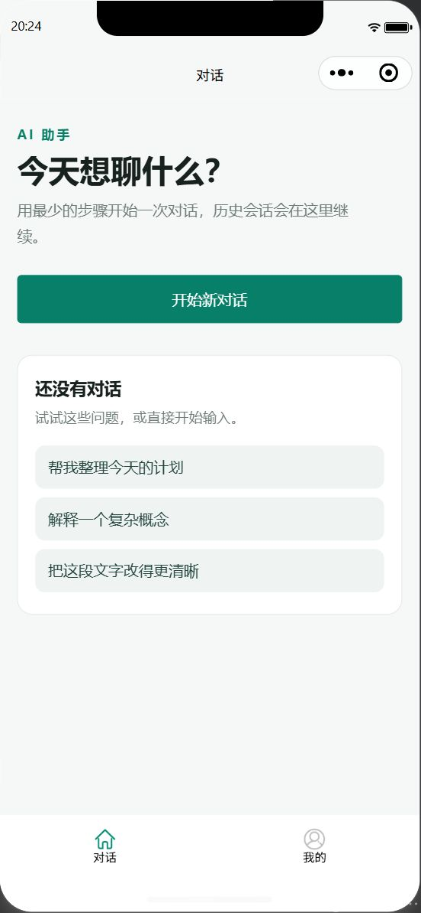
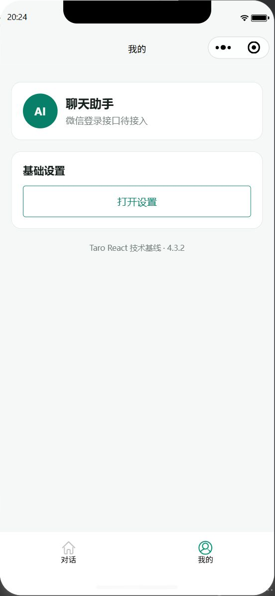

# Taro 技术基线验证

日期：2026-11-07

## 环境

- Taro 4.3.2
- React 18.3.1
- 微信开发者工具基础库 3.17.5
- 微信 AppID：`wx0b7d4bcc943343c6`

## 结果

| 验证项 | 结果 | 证据 |
| --- | --- | --- |
| Taro 微信生产构建 | 通过 | `pnpm build:weapp` 成功生成 `dist/weapp` |
| 自定义 tabbar | 通过 | `dist/custom-tab-bar` 产物存在，模拟器两个 tab 和选中态正常 |
| Taroify | 通过 | Button 按需引入并在页面正常渲染，页面主色为 `#087f68` |
| OpenAPI 客户端 | 通过 | `pnpm contract:check` 生成 `src/service` 并校验关键 operationId |
| SSE | 通过 | 3 个测试文件、7 个用例通过，覆盖 UTF-8 拆包、SSE 解析、Taro chunk 请求和 abort |

## 模拟器证据

## Console / Network

- Console 中 `grep -i error` 无结果。
- 应用未发起业务请求；Network 仅包含微信开发者工具自身的 SDK 上报请求。
