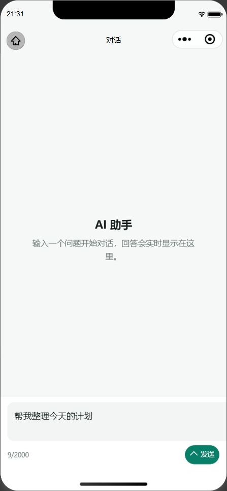

# Taro 技术基线验证

日期：2026-11-07

## 工具链

| 通道 | 组件 | 版本 |
| --- | --- | --- |
| 通用 | Node.js | 24.16.0 |
| 通用 | pnpm | 10.34.9 |
| 小程序 / H5 构建 | Taro | 4.3.2 |
| 小程序 / H5 构建 | Vite | 4.5.14 |
| 小程序 / H5 构建 | `@vitejs/plugin-react` | 4.7.0 |
| 小程序 / H5 构建 | React | 18.3.1 |
| 测试 | Vitest | 5.1.0 |
| 测试 | Vite | 8.3.6 |

说明：Taro 4.3.2 的 Vite Runner peer dependency 仍为 Vite `^4`，因此构建与测试采用两条隔离通道，详见 [ADR-0004](../decisions/0004-toolchain-lanes.md)。

## 结果

| 验证项 | 结果 | 证据 |
| --- | --- | --- |
| 冻结锁文件安装 | 通过 | `pnpm install --frozen-lockfile` |
| API 契约 | 通过 | `pnpm contract:check` |
| 应用类型检查 | 通过 | `pnpm typecheck` |
| 测试类型检查 | 通过 | `pnpm test:typecheck` |
| Lint | 通过 | `pnpm lint`，覆盖 `src` 和 `tests` |
| 单元与组件测试 | 通过 | 7 个测试文件、19 个用例 |
| 工具链断言 | 通过 | `pnpm toolchain:check` |
| 微信生产构建 | 通过 | `pnpm build:weapp` |
| H5 生产构建 | 通过 | `pnpm build:h5` |
| 重复干净构建 | 通过 | 连续构建文件清单一致，`common.js` 哈希一致 |
| 微信运行时 | 通过 | 页面正常、Console 无错误 |

`pnpm check` 已串联上述契约、类型、Lint、测试、工具链和双端构建。

## 构建产物

- 微信小程序：`dist/weapp`
- H5：`dist/h5`
- 微信共享模块：`common.js`、`vendors.js`、`taro.js`
- H5 标题：`小翟 AI 聊天助手`

## 缓存与兼容

- 构建前自动清理 `dist/weapp` 或 `dist/h5`，避免 Taro `emptyOutDir:false` 残留旧 chunk。
- Vitest 缓存固定在 `.cache/vitest`，与 Taro 构建缓存隔离。
- 仓库根目录不再保留 `.pnpm-store`，并已加入 `.gitignore`。
- `project.config.json` 保留 `ignoreDevUnusedFiles:false` 与 `ignoreUploadUnusedFiles:false`，避免微信开发者工具遗漏 Taro 生成的 `common.js`。
- 微信验收前执行了编译缓存和项目文件索引清理，并重新打开项目。

## 模拟器证据

## Console / Network

- Console 只包含微信基础库信息和 `App launched.`，无应用错误。
- 当前未发起后端业务请求，等待 FastAPI 服务接入后执行真实 SSE 验收。

## 已知警告

当前 Taro 4.3.2 的 Vite 4 构建会输出 Sass `legacy-js-api` 弃用警告。该警告来自 Taro Vite Runner 的 Sass 调用方式，不影响构建结果；待 Taro 支持更高 Vite 主版本后再移除。
