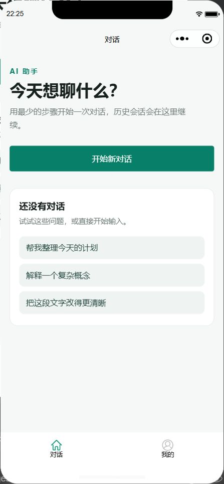
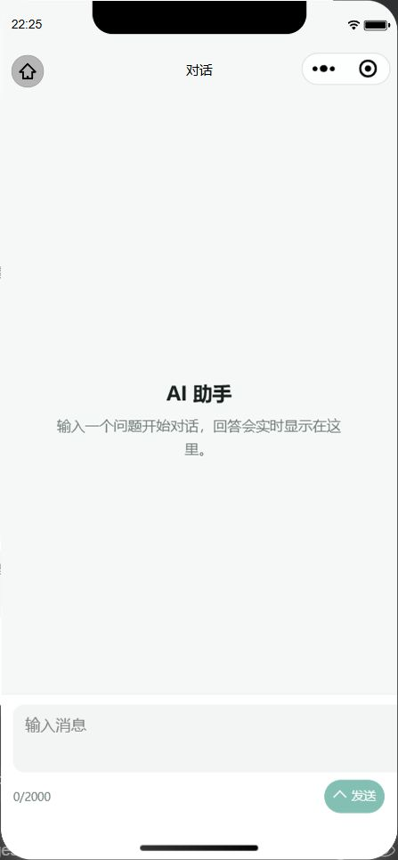
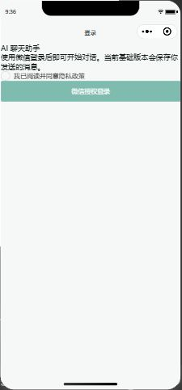
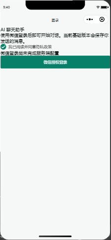

# Taro 技术基线验证

日期：2026-11-07

## 工具链

| 通道             | 组件                   | 版本    |
| ---------------- | ---------------------- | ------- |
| 通用             | Node.js                | 24.16.0 |
| 通用             | pnpm                   | 10.34.9 |
| 小程序 / H5 构建 | Taro                   | 4.3.2   |
| 小程序 / H5 构建 | Vite                   | 4.5.14  |
| 小程序 / H5 构建 | `@vitejs/plugin-react` | 4.7.0   |
| 小程序 / H5 构建 | React                  | 18.3.1  |
| 测试             | Vitest                 | 5.1.0   |
| 测试             | Vite                   | 8.3.6   |

说明：Taro 4.3.2 的 Vite Runner peer dependency 仍为 Vite `^4`，因此构建与测试采用两条隔离通道，详见
[ADR-0004](../decisions/0004-toolchain-lanes.md)。

## 结果

| 验证项              | 结果 | 证据                                                                    |
| ------------------- | ---- | ----------------------------------------------------------------------- |
| 冻结锁文件安装      | 通过 | `pnpm install --frozen-lockfile`                                        |
| API 契约            | 通过 | `pnpm contract:check`                                                   |
| 应用类型检查        | 通过 | `pnpm typecheck`                                                        |
| 测试类型检查        | 通过 | `pnpm test:typecheck`                                                   |
| Lint                | 通过 | `pnpm lint`，覆盖严格源码、测试、样式、架构和依赖                       |
| TypeScript 严格检查 | 通过 | `strict`、`noUncheckedIndexedAccess`、`exactOptionalPropertyTypes`      |
| 类型感知 ESLint     | 通过 | strict/stylistic type-checked、projectService、无 unsafe 和 no-inline   |
| 架构故障注入        | 通过 | `pnpm lint:architecture`，Taro 直连、Stateful View 和缺失三层文件均失败 |
| Vitest ESLint       | 通过 | `@vitest/eslint-plugin` 与 Testing Library 规则                         |
| Stylelint           | 通过 | `stylelint-config-standard-scss`，Taro/BEM 规则适配                     |
| Prettier            | 通过 | `pnpm format:check`，严格 JSX、Markdown 与统一换行                      |
| Knip                | 通过 | Taro 动态入口配置完成后为 0 报告                                        |
| 单元与组件测试      | 通过 | 16 个测试文件、34 个用例                                                |
| 工具链断言          | 通过 | `pnpm toolchain:check`                                                  |
| 微信生产构建        | 通过 | `pnpm build:weapp`                                                      |
| H5 生产构建         | 通过 | `pnpm build:h5`                                                         |
| 重复干净构建        | 通过 | 连续构建文件清单一致，`common.js` 哈希一致                              |
| 微信运行时          | 通过 | 页面正常、Console 无错误                                                |

`pnpm check` 已串联上述契约、类型、Lint、测试、工具链和双端构建。

## 源码结构验收

- Taro 保留 `src/app.*`、`src/pages` 和页面 `*.config.ts` 框架约定。
- 聊天与认证按 `features` 组织，页面只使用 feature `public.ts` 和 shared UI。
- Chat Model 不依赖 React、Taro、Zustand、OpenAPI DTO 或 SSE 传输。
- Chat Store 只保存可序列化状态和同步 `applyDomainAction`。
- Chat Controller 独立管理 API、SSE、取消、重试、连接注册和对账。
- OpenAPI DTO 在 feature API Mapper 边界转换为领域模型。
- 通用 SSE parser 只返回 `SseMessage`，聊天事件语义位于 chat feature。
- Shared 层不依赖 features、pages 或业务 Store。
- OpenAPI 生成物位于 `src/generated/openapi`，契约生成与检查通过。
- 基础组件和图标统一通过 `src/shared/ui/shell.ts` 导出。
- 交互型 View 已拆分为 View、同名 Hook 和 Model，TSX 不再持有 React 状态或 Taro 调用。
- Taroify Button、Textarea 和图标已接入，AppIcon 手写图标已移除。

## 构建产物

- 微信小程序：`dist/weapp`
- H5：`dist/h5`
- 微信共享模块：`common.js`、`vendors.js`、`taro.js`
- H5 标题：`小翟 AI 聊天助手`

## 缓存与兼容

- 构建前自动清理 `dist/weapp` 或 `dist/h5`，避免 Taro `emptyOutDir:false` 残留旧 chunk。
- `clean:build` 统一清理根级 `dist`，`clean:deps-cache` 同时清理测试 Vite 临时缓存。
- Vitest 缓存固定在 `.cache/vitest`，与 Taro 构建缓存隔离。
- 仓库根目录不再保留 `.pnpm-store`，并已加入 `.gitignore`。
- 最终工作区不再保留 `dist`、`.swc`、构建缓存或空目录。
- 已移除迁移遗留的旧目录结构和过期 QA 截图，仅保留当前 `view-shell` 截图。
- `project.config.json` 保留 `ignoreDevUnusedFiles:false` 与
  `ignoreUploadUnusedFiles:false`，避免微信开发者工具遗漏 Taro 生成的 `common.js`。
- 微信验收前执行了编译缓存和项目文件索引清理，并重新打开项目。

## 模拟器证据

## Console / Network

- 2026-11-07 基线：`get_simulator_console --command "grep -i error"`
  返回空结果，无应用错误；当时尚未接入 FastAPI 业务请求。

## 2026-11-08 登录与单条消息垂直切片

| 验收项                | 结果 | 证据                                                      |
| --------------------- | ---- | --------------------------------------------------------- |
| PostgreSQL 数据库     | 通过 | `zai-wp-chat`，owner `zai_wp_chat_owner`，UTF8            |
| Alembic 迁移          | 通过 | revision `20261108_0001`                                  |
| 数据表                | 通过 | `users`、`messages`                                       |
| 后端测试              | 通过 | 3 passed：登录、幂等、隔离、refresh、logout               |
| 后端静态检查          | 通过 | Ruff、format、Pyright strict                              |
| 前端测试              | 通过 | 17 个测试文件、40 个用例                                  |
| 前端静态检查          | 通过 | typecheck、ESLint、Stylelint、ls-lint、架构检查           |
| API 契约              | 通过 | `pnpm contract:check`                                     |
| 微信构建              | 通过 | `pnpm build:weapp`                                        |
| H5 构建               | 通过 | `pnpm build:h5`                                           |
| FastAPI 实际启动      | 通过 | health 200、OpenAPI 200                                   |
| 微信模拟器            | 通过 | 当前页 `pages/login/index`，Console 无应用异常            |
| 小程序到 FastAPI      | 通过 | Network 命中 `http://127.0.0.1:8000/api/v1/auth/wx-login` |
| 未配置 AppSecret 行为 | 通过 | 登录返回 503 `WECHAT_NOT_CONFIGURED` 并显示服务端配置提示 |

当前未包含 AI 模型、run 和 SSE 真实回复。微信真实登录需在 `backend/.env` 写入有效 `WX_APP_SECRET`
后，用微信开发者工具执行真机或模拟器验收。

运行态证据：

## 已知警告

当前 Taro 4.3.2 的 Vite 4 构建会输出 Sass `legacy-js-api` 弃用警告。该警告来自 Taro Vite
Runner 的 Sass 调用方式，不影响构建结果；待 Taro 支持更高 Vite 主版本后再移除。
